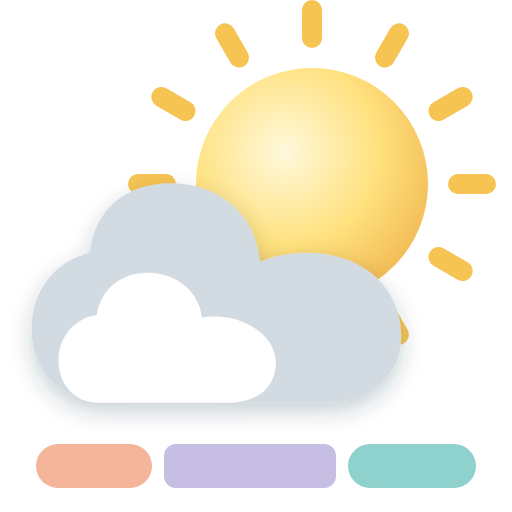
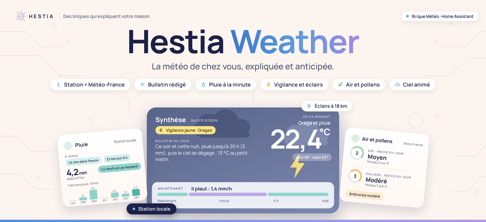
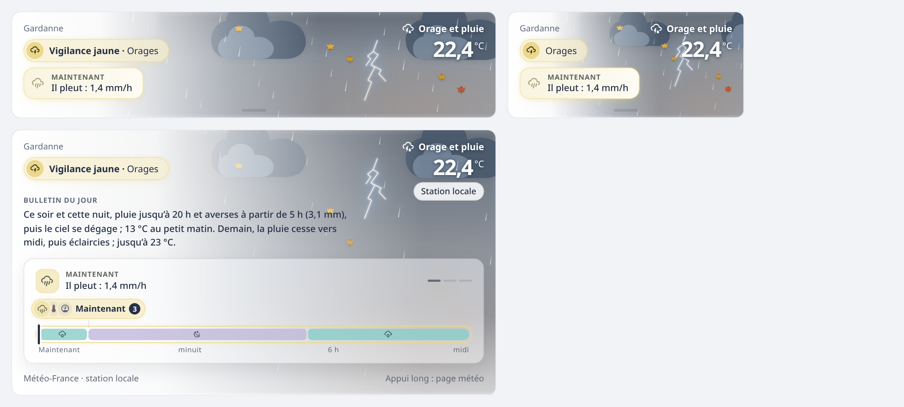

# Hestia Weather — intégration

**Le cerveau de la météo chez vous.** L’intégration lit vos prévisions, votre station et la qualité de l’air. Elle calcule ce qu’ils veulent dire : ressenti, alertes, bulletin du jour, pluie à venir, tendances, bilans.

Elle donne le résultat à **sa carte**, fournie avec elle, et à vos automatisations.

## Pourquoi

Une station météo donne des chiffres ; Météo-France donne des prévisions pour la commune. Hestia Weather les met ensemble et les explique :

- **Maintenant** : ce que l’on ressent vraiment, et pourquoi (humidité, soleil, vent, pluie).
- **À venir** : la pluie, l’orage, le gel des prochaines heures, à leur heure.
- **Ce qui compte** : la vigilance officielle, l’alerte mesurée chez vous, l’air et les pollens.
- **Le bulletin du jour**, rédigé comme une prévision : « Ce soir et cette nuit, pluie jusqu’à 20 h (3 mm) ; 13 °C au petit matin. »

Tout est calculé une fois, dans Home Assistant : la carte affiche, vos automatisations utilisent les mêmes valeurs.

## Ce qu’il faut

- Home Assistant **2026.7** ou plus récent.
- Une entité météo `weather.*`. **Météo-France** est conseillée.
- En plus, si vous en avez : une station météo, les vigilances de Météo-France ou de MeteoSwiss, Atmo France (air et pollens), Polleninformation, IRM KMI, Swiss Pollen ou Kleenex / Scottex, Vigieau (restrictions d’eau), Blitzortung (éclairs).

## Installation

1. Dans HACS, ⋮ → **Dépôts personnalisés** : ajoutez `https://github.com/hestiaFB/hestia-weather-integration`, catégorie **Intégration**.
2. Installez **Hestia Weather**, puis redémarrez Home Assistant.
3. **Paramètres → Appareils et services → Ajouter une intégration → Hestia Weather.**
4. Sur un tableau de bord : **Ajouter une carte → Hestia Weather**. La carte est fournie par l’intégration (depuis la 2.3) : rien d’autre à installer.

## Configuration

Tout se règle dans le panneau **Hestia** de la barre latérale, onglet **Météo**. Pas de YAML. Chaque champ est déjà rempli avec ce que Home Assistant connaît : vous vérifiez, vous corrigez si besoin.

- **Accueil** : à lire seulement. L’état de chaque lieu, ce qui reste à régler, les extensions, les versions.
- **Réglages généraux** : vos lieux (**Modifier**, **Ajouter un lieu**) et les cartes.
- **Extensions** : les intégrations que Hestia Weather sait lire, rangées par thème, et la liaison avec Hestia Confort.

Un lieu se règle en sept étapes : Sources météo, Station météo, Qualité de l’air, Pollens, Eau et jardin, Entités, puis le récapitulatif. Rien n’est enregistré avant **Enregistrer**. Un champ laissé vide est un choix : il n’est jamais rempli à votre place.

Le panneau s’adapte au téléphone. Dans **Accueil Hestia → Réglages**, choisissez le thème de Home Assistant ou celui de Hestia, et masquez l’entrée du menu si vous le voulez. [Détail des sources et des réglages](docs/sources.md).

## La carte

Douze cartes, rangées en trois types dans **Ajouter une carte** : **Hestia - Météo** (complète, tuile, tuile dépliée), **Hestia - À la pièce** (ressenti, pluie, vent, pression, éclairs, air et pollens, prévisions) et **Hestia - Petite carte** (mini, alerte). Chacune montre les parties que vous cochez. Toutes s’écrivent `type: custom:hestia-weather-card`, seul `format` change. [La carte en détail : formats, réglages, visuel](docs/carte/README.md).

Vous aviez installé la carte depuis HACS ? **Retirez-la de HACS**, puis rechargez la page : vos cartes restent en place. Tant qu’elle reste installée, l’accueil du panneau **Hestia** l’indique en orange.

Dans l’application Home Assistant, une carte reste invisible juste après une mise à jour ? Réinitialisez son cache : **Paramètres → Application compagnon → Dépannage → Réinitialiser le cache du frontend**.

## Les capteurs et les automatisations

Hestia Weather dit ce que la météo implique ; vos automatisations décident quoi en faire. Les entités sont rangées en sept familles :

| Famille | Par exemple |
| --- | --- |
| **Maintenant** | Ressenti, point de rosée, temps observé, pluie en cours |
| **Alertes** | Vigilance officielle (Météo-France ou MétéoSuisse), orage, vent fort, pluie forte, gel, canicule |
| **Prochaines heures** | Pluie dans l’heure, sur 6 h et 24 h, minimale de la nuit, maximale de demain |
| **Jardin** | Pluie des 7 derniers jours |
| **Bâtiment** | Degrés-jours de chauffe et de climatisation |
| **Énergie** | Ensoleillement de demain |
| **Vie pratique** | Séchage du linge, givre sur le pare-brise, qualité de l’air, pollens |

Chaque entité dit **pourquoi** (attribut `raison`) et **d’où vient** sa valeur (`source`). En plus des capteurs :

- l’évènement **`hestia_weather_alerte`**, au début, au changement et à la fin de chaque alerte ;
- l’action **`hestia_weather.prevision`**, qui répond à « quel temps entre 16 h 15 et 17 h ? » ;
- l’entité **`weather.hestia_weather`** (à activer) : le temps vu par votre station, avec les prévisions du fournisseur ;
- des **modèles d’automatisation** à importer en un clic : notifier les alertes, protéger avant le gel, le bulletin du matin.

[Toutes les entités, leurs rôles et les modèles à importer](docs/capteurs.md). Un deuxième lieu ajoute son nom : `sensor.hestia_weather_marseille_ressenti`. Une valeur inconnue reste **inconnue** : rien n’est inventé.

## Langues

Hestia Weather parle **français** et **anglais**. La carte, le panneau et les noms des entités suivent la langue de Home Assistant ; toute autre langue s’affiche en anglais pour l’instant.

Les valeurs des capteurs (bulletin, raisons, alertes) restent en français, pour que vos automatisations ne changent pas avec la langue.

**D’autres langues arriveront, avec votre aide.** Hestia est un projet d’entraide : vous parlez allemand, néerlandais, italien, espagnol… ? [Proposez votre traduction](https://github.com/hestiaFB/hestia-weather-integration/issues/new?title=Traduction%20%3A%20) : une liste de phrases à traduire, sans rien connaître au code. Votre nom sera cité.

> **In English.** Hestia Weather speaks French and English. More languages will come through mutual help: if you speak another language, [offer a translation](https://github.com/hestiaFB/hestia-weather-integration/issues/new?title=Translation%3A%20). No coding needed.

## Documentation

| Page | Ce qu’elle explique |
| --- | --- |
| [La carte](docs/carte/README.md) | Les douze cartes, le bandeau, les réglages, le visuel, les messages |
| [Les capteurs et les automatisations](docs/capteurs.md) | Les sept familles d’entités, l’évènement d’alerte, l’action, l’entité météo, les modèles à importer |
| [Le ressenti](docs/ressenti.md) | Humidex, effets du vent, du soleil, de la pluie et de la nuit, mots et nuances, alerte de la station |
| [La synthèse et les alertes](docs/synthese.md) | Les points retenus, leurs seuils, les niveaux, la vigilance officielle |
| [Le bulletin du jour](docs/bulletin.md) | Comment il est rédigé |
| [Sources et réglages](docs/sources.md) | Météo-France, station, soleil, Atmo France, Vigieau, Blitzortung, historique, toutes les clés |
| [Pluie, vent, pression](docs/mesures.md) | Cumuls, courbes, tendances, ce qui est calculé depuis l’historique |
| [Fonctionnement technique](docs/technique.md) | Moteur, coordinateur, capteurs, API, tests ; le code de la carte est dans `card/` |

## Limites

Le ressenti est une **estimation locale**, pas une mesure physiologique ni une vigilance officielle. Hestia Weather n’est pas un modèle de prévision : il lit et explique les prévisions de votre fournisseur. Il ne détecte pas la foudre lui-même : il lit Blitzortung, si vous l’avez. Ses alertes ne remplacent ni la vigilance Météo-France ni les consignes de sécurité.

## Noms techniques

Le nom technique de l’intégration est `hestia_weather` : l’action `hestia_weather.prevision`, la carte `custom:hestia-weather-card`, l’évènement `hestia_weather_alerte`, les variables de thème `hestia-rain-color`…

Installée sous son nom technique d’origine, l’intégration passe seule au nouveau au premier démarrage de la mise à jour :

- vos lieux, réglages, alertes en cours, historiques et statistiques sont gardés ;
- vos entités gardent leur nom, et donc vos automatisations et vos tableaux de bord aussi ;
- les automatisations, scripts, scènes et tableaux de bord faits dans l’interface sont mis à jour ;
- ce qui est écrit à la main en YAML n’est jamais modifié : une réparation dans **Paramètres** liste les fichiers et les lignes à changer.

Hestia Weather 3.x va avec Hestia Confort 2.x : mettez-les à jour ensemble.

**Entités** : une nouvelle installation crée des `sensor.hestia_weather_…`. Installée avant la 2.9.4, vos entités gardent leur nom d’origine. Pour leur donner le nom Hestia, **Réglages généraux → Nom des entités** : un aperçu d’abord, puis vos automatisations, scripts, scènes et tableaux de bord suivent, et un retour en arrière reste possible.
