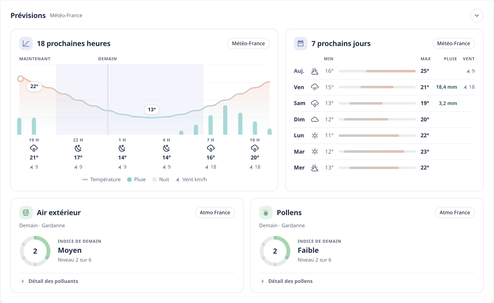

# La carte Niak Weather

**La météo chez vous, en une carte qui parle.** La carte affiche ce que calcule l’intégration : la vigilance, le bulletin du jour, les alertes à leur heure, le ressenti, la pluie, le vent, la pression, l’air et les pollens, sur un ciel animé.

Depuis la 2.3, **la carte est fournie par l’intégration** : rien à installer en plus, et elle a toujours la même version que l’intégration. L’intégration l’ajoute elle-même aux ressources des tableaux de bord (`/niak_weather-assets/niak-weather-card.js`) et la tient à jour, pour que l’application mobile la trouve aussi. Sur un tableau de bord : **Ajouter une carte → Niak Weather**.

Correction du chargement (2.3.1) : la carte attend l’initialisation de l’interface Home Assistant avant d’enregistrer ses éléments, même si une ancienne page en cache la charge très tôt. Les ressources gérées par l’interface utilisent uniquement la ressource module ; les ressources YAML gardent un chargement automatique protégé. Les contournements locaux avec `%2D` sont regroupés avec la ressource officielle lors du démarrage, sans toucher aux ressources YAML.

Sans station (depuis la 2.3.1), les courbes de vent et de pression utilisent les attributs historiques du service météo sélectionné, si Home Assistant les a enregistrés. Elles conservent le nom du service météo et ne deviennent pas des mesures locales. Si cet historique est absent, exclu de Recorder ou trop court, la carte le précise ; elle n’invente pas de valeurs passées. Les cumuls de pluie mesurés restent un enrichissement facultatif fourni par un pluviomètre. Retirer la station ne crée plus d’alertes « À régler » pour les entités restées actives qui dépendent de ses capteurs.

Vous aviez installé la carte depuis HACS ? Retirez-la (HACS → Niak Weather → ⋮ → **Supprimer**), puis rechargez la page. Vos cartes restent en place : elles s’écrivent toujours `type: custom:niak-weather-card`. Tant qu’elle reste installée, l’accueil du panneau **Niak** l’indique en orange.

Dans l’application Home Assistant, une carte reste invisible juste après une mise à jour ? Réinitialisez son cache : **Paramètres → Application compagnon → Dépannage → Réinitialiser le cache du frontend**.


## Sept cartes à choisir

Dans **Ajouter une carte**, cherchez « Niak Weather » : chaque carte a son aperçu. Toutes s’écrivent `type: custom:niak-weather-card`, seul `format` change.

| Carte | Pour quoi |
| --- | --- |
| **Complète** (`full`, par défaut) | Une page météo : le bandeau, puis **Aujourd’hui** et **Prévisions**, qui se replient d’un appui sur leur titre. |
| **Tuile** (`tile`) | La page d’accueil, en pleine ou demi-largeur : le lieu, la vigilance, la bulle qui défile et la météo du moment. **Un appui** la déplie sur place, **un appui long** ouvre la carte complète par-dessus la page. |
| **Tuile dépliée** (`intermediate`) | La même tuile, ouverte au départ. |
| **Mini** (`mini`) | Une seule ligne : le ciel, la température, le lieu et la vigilance. Pour un en-tête ou un téléphone. Un appui ouvre la carte complète. |
| **Prévisions** (`forecast`) | La courbe des 18 prochaines heures ou le tableau des 7 jours, avec le bouton **Heures / Jours**. |
| **Pluie** (`rain`) | La pluie à venir (dans l’heure, sur 6 h, la prochaine averse), celle qui tombe et celle des 7 derniers jours. |
| **Alerte** (`alert`) | Visible seulement en cas de vigilance, d’alerte mesurée chez vous ou de point sérieux à venir. Cachée quand tout est calme. Un appui ouvre la carte complète. |

**Le contenu se choisit**, dans l’ordre voulu :

- **Tuile dépliée** : le bulletin du jour, les événements (la frise), les prochains moments (cet après-midi, ce soir, cette nuit, demain matin) et les prévisions avec **Heures / Jours** (température, pluie, vent et sa direction). Par défaut : le bulletin et les événements.
- **Complète** : trois sections, toujours dans cet ordre, chacune avec son propre contenu :
  - **le bandeau intelligent**, avec son ciel animé : bulletin, événements, prochains moments, prévisions en tuiles ;
  - **Aujourd’hui** : pluie, vent, pression (et ressenti, pastilles, air et pollens du jour) ;
  - **Prévisions** : les 18 prochaines heures, les 7 prochains jours (et l’air et les pollens de demain).


## Le bandeau

- **La vigilance officielle**, quand il y en a une : une pastille compacte, l’icône du phénomène dans un disque de la couleur du niveau, avec un halo.
- **Le bulletin du jour**, en entier.
- **Les événements des heures à venir**, sur une frise dans un verre dépoli :
  - une phrase qui défile parcourt les points un à un ;
  - chaque point est une étiquette à son heure (pluie, orage, gel, brouillard, température, pluie de demain, air et pollens dès 3 sur 6), jusqu’à 6 ; ceux du moment sont réunis dans « Maintenant » ;
  - l’alerte mesurée chez vous ouvre cette étiquette, avec son halo ;
  - la piste suit le ciel prévu heure par heure ;
  - sur un téléphone, les étiquettes ne gardent que leurs icônes quand elles ne tiennent pas toutes.

  Un appui sur une étiquette affiche son point ; le défilement se met en pause au survol.
- **La météo du moment** à droite : ciel, température, tendance, source.

Derrière, **le ciel animé** suit le temps du moment :

- soleil à rayons, lune à cratères, nuages, orages avec éclairs, rafales ;
- la neige tombe et tient au sol, la grêle rebondit, la pluie éclabousse ;
- les saisons s’y glissent : pétales, chaleur, feuilles rousses, givre.


## Aujourd’hui et Prévisions

- **Aujourd’hui** : le ressenti et ce qui le fait monter ou baisser (un **i** détaille le calcul), puis Pluie, Vent et Pression, chacun avec sa valeur, un petit graphique et trois chiffres utiles. Ensuite, l’air extérieur et les pollens.
- **Prévisions** : la courbe des 18 prochaines heures, le tableau des 7 jours, l’air et les pollens de demain.

Un appui sur une valeur ouvre la fiche de son capteur.



## Réglages

Tout se règle dans l’éditeur de la carte, rangé en blocs : le lieu et le format en haut, puis **Visuel et performance**, **Bandeau**, **Sections** et **Air et pollens** (pour une tuile : **Contenu** et **Fonctionnalités**). Les sources, elles, se règlent dans l’intégration.

| Bloc | Réglage | Par défaut | Rôle |
| --- | --- | --- | --- |
| En haut | `entry_id` | — | Le lieu à afficher, s’il y en a plusieurs dans l’intégration |
| En haut | `format` | `full` | `full`, `tile`, `intermediate`, `mini`, `forecast`, `rain` ou `alert` |
| Bandeau intelligent (complète) | `banner_blocks` | `bulletin`, `events` | Sous le lieu, la vigilance et la météo du moment, dans l’ordre : `bulletin`, `events` (la frise), `moments`, `forecast` (les prévisions en tuiles). Le bandeau et son ciel animé restent toujours |
| Bandeau intelligent (complète) | `clock` | `none` | L’heure de l’appareil dans le bandeau : `left` en grand sous le titre, `right` au-dessus de « En ce moment », `none` masquée |
| Aujourd’hui (complète) | `today_blocks` | tout | `rain`, `wind`, `pressure`, `comfort` (ressenti), `extras` (pastilles), `air` (air et pollens du jour). Une liste vide retire la section |
| Aujourd’hui (complète) | `rain_span` | `7d` | Les barres de pluie : `24h` (une par heure), `7d` (une par jour) ou `30d` (une par jour). 24 heures et 30 jours demandent un pluviomètre dont Home Assistant garde les statistiques ; sinon, 7 jours |
| Aujourd’hui (complète) | `wind_span` | `6h` | La courbe du vent sur `6h`, `1d` (24 heures), `2d` (2 jours) ou `7d` (7 jours). Au-delà de 6 h, les moyennes horaires et les rafales maximales de chaque heure |
| Aujourd’hui (complète) | `pressure_span` | `6h` | La courbe de pression sur `6h`, `1d` (24 heures), `2d` (2 jours) ou `7d` (7 jours). Au-delà de 6 h, les moyennes horaires gardées par Home Assistant |
| Prévisions (complète) | `forecast_blocks` | tout | `hours` (18 heures), `days` (7 jours), `air` (air et pollens de demain). Une liste vide retire la section |
| Contenu (tuile) | `tile_blocks` | `bulletin`, `events` | Ce que montre la tuile dépliée, dans l’ordre : `bulletin`, `events`, `moments`, `forecast` |
| Contenu (tuile), Prévisions | `forecast_tab` | `hours` | Les prévisions s’ouvrent sur les heures (`hours`) ou les jours (`days`). Un appui sur Heures / Jours change l’affichage, gardé sur chaque appareil |
| Visuel et performance | `weather_animations` | `true` | Ciel animé, défilement et halos. Coupées, le décor reste fixe |
| Visuel et performance | `weather_animation_quality` | `standard` | `low` : moins de gouttes, de flocons et de nuages (choisi d’office sur écran tactile pour la tuile) |
| Visuel et performance | `glass_effect` | `true` | Effet verre dépoli sur le ciel. Le flou est ce qui coûte le plus : à couper sur un appareil lent |
| Bandeau | `show_synthesis` | `true` | Complète : afficher le bandeau |
| Bandeau | `show_bulletin` | `true` | Afficher le bulletin du jour |
| Bandeau | `smart_brief` | `true` | Complète : afficher la vigilance, l’alerte mesurée et les événements (sinon, la frise ne montre que le ciel prévu) |
| Sections | `show_today`, `show_predictions` | `true` | Complète : afficher les sections Aujourd’hui et Prévisions |
| Sections | `collapse_today`, `collapse_predictions` | `false` | Complète : section repliée au départ |
| Air et pollens | `show_atmo_details` | `true` | Le pli « Détail » des polluants et des pollens |
| Air et pollens | `show_atmo_tomorrow` | `true` | L’air et les pollens de demain |
| Fonctionnalités (tuile, mini, alerte) | `hold_action` | `popup` | Ce que fait l’appui long (l’appui pour Mini et Alerte) : `popup` ouvre la météo complète en fenêtre, `page` ouvre la page `weather_path`, `none` ne fait rien (la tuile se déplie seulement) |
| Fonctionnalités (tuile, mini, alerte) | `weather_path` | — | La page ouverte avec `hold_action: page`, par exemple `/meteo` |

Configuration minimale, avec un seul lieu :

```yaml
type: custom:niak-weather-card
```

Une tuile qui mène à votre page météo :

```yaml
type: custom:niak-weather-card
format: tile
hold_action: page
weather_path: /meteo
```

Une tuile dépliée comme en 1.20, avec les moments et les prévisions :

```yaml
type: custom:niak-weather-card
format: intermediate
tile_blocks: [bulletin, moments, forecast]
```

## Le visuel

- **Une seule charte** pour toutes les cartes : mêmes bulles, mêmes pastilles, mêmes cadres, une palette de couleurs douces accordées entre elles. Elle suit le thème Home Assistant, clair ou sombre.
- **Le contour coloré et le halo** sont réservés aux alertes ; le halo respire doucement, sans clignoter.
- **Les animations** se mettent en pause hors de l’écran, et suivent le réglage « réduire les animations » de l’appareil.
- **Les couleurs de sens** se remplacent dans un thème Home Assistant, si vous le souhaitez :

```yaml
niak-rain-color: "#4fb3bf"
niak-level1-color: "#f2c94c"
```

Variables : `niak-rain-color`, `niak-wind-color`, `niak-heat-color`, `niak-cold-color`, `niak-calm-color`, `niak-pressure-color`, `niak-level1-color`, `niak-level2-color`, `niak-level3-color`.

[La charte en détail](charte.md).

## Si la carte affiche un message

| Message | Que faire |
| --- | --- |
| Niak Weather a besoin de son intégration | Déjà téléchargée depuis HACS ? Ajoutez-la dans **Paramètres → Appareils et services** : Home Assistant ne la démarre qu’une fois ajoutée. Sinon, [installez-la](https://github.com/Niakman13/niak-weather-integration#installation), redémarrez, puis ajoutez-la. |
| Ajoutez l’intégration Niak Weather | Elle est installée : ajoutez-la dans **Paramètres → Appareils et services**. |
| Choisissez un lieu | Plusieurs lieux existent : choisissez celui de la carte dans ses réglages. |
| Rechargez la page | L’intégration vient d’être mise à jour : rechargez la page (**Ctrl+F5** sur ordinateur). |

## Développement

Le code de la carte est dans [`card/`](../../card) ; il est compilé dans `custom_components/niak_weather/frontend/niak-weather-card.js`.

```sh
cd card
npm ci
npm run validate
npx playwright install chromium
npm run test:browser
```

Le banc dessine ses démonstrations avec le vrai moteur de l’intégration (Python 3.13). [Charte et organisation du code](charte.md).
